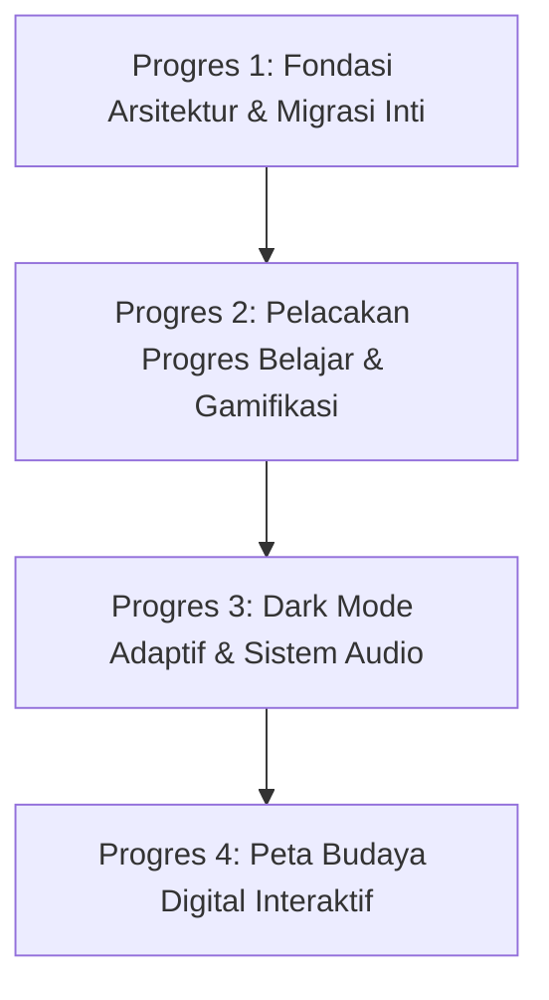

# DOKUMEN ANALISIS TRANSFORMASI SISTEM & PEDOMAN LAPORAN PENGEMBANGAN
## "NusaLearn: Eksplorasi Budaya dan Pahlawan Indonesia"
**Transformasi Multimedia Pembelajaran Interaktif (Web Wrapper) Menjadi Aplikasi Mobile Native Murni (Flutter & Dart)**

---

### Informasi Proyek & Pengembang
* **Nama Aplikasi:** NusaLearn Mobile
* **Pengembang:** Ibnaty Chalisa Adabina
* **NPM:** 2413025061
* **Kelas:** PTI24 A
* **Program Studi:** Pendidikan Teknologi Informasi
* **Jurusan:** Pendidikan Ilmu Pengetahuan Sosial
* **Fakultas:** Keguruan dan Ilmu Pendidikan, Universitas Lampung (2026)
* **Mata Kuliah:** Mobile Programming
* **Target Pengguna:** Siswa Sekolah Dasar (Kelas 4–6) dan Siswa Sekolah Menengah Pertama (SMP)
* **Teknologi Utama:** Flutter 3.47+ (Dart 3.13+), Material Design 3, SharedPreferences, AudioPlayers, Confetti, Google Fonts

---

## 1. Latar Belakang & Identifikasi Masalah

NusaLearn pada mulanya dirancang sebagai media pembelajaran interaktif berbasis web (*HTML5, CSS3, dan Vanilla JavaScript*) yang kemudian dibungkus (*wrapper*) menjadi berkas instalasi Android (APK) menggunakan platform generator pihak ketiga seperti AppsGeyser. 

Meskipun konten edukasi kebudayaan nusantara dan pahlawan nasional telah tersusun lengkap, solusi *web wrapper* tersebut menghadapi kendala teknis dan pedagogis yang signifikan:
1. **Keterbatasan Performa WebView:** Eksekusi antarmuka melalui mesin WebView menimbulkan *framerate drop* (di bawah 60 FPS), konsumsi memori tinggi, serta animasi transisi yang tersendat (*jank*) pada smartphone spesifikasi menengah ke bawah.
2. **Ketiadaan Navigasi Native:** Alur navigasi hanya mengandalkan manipulasi visibilitas elemen DOM (CSS `display: none / block`). Pengguna tidak dapat memanfaatkan gestur geser (*swipe to back*) maupun tombol kembali fisik perangkat secara alami.
3. **Penyimpanan State yang Rapuh:** Skor kuis dan progres eksplorasi tidak tersimpan secara persisten. Begitu sesi aplikasi terhenti atau dibersihkan dari RAM, seluruh riwayat belajar hilang.
4. **Keterbatasan Eksplorasi Spasial:** Informasi kebudayaan hanya disajikan dalam bentuk daftar kartu linear tanpa visualisasi geografis interaktif yang menghubungkan letak wilayah dengan kebudayaan lokal.
5. **Standar Akademik Rekayasa Perangkat Lunak:** Untuk memenuhi kualifikasi proyek perkuliahan *Mobile Programming*, aplikasi wajib dibangun menggunakan fondasi arsitektur perangkat lunak mobile murni (*Clean Layered Architecture*) yang modular, teruji, dan mudah dipelihara.

---

## 2. Inventarisasi Aset & Data Edukasi

Seluruh materi pembelajaran dan aset visual berhasil dimigrasikan secara penuh ke dalam ekosistem Flutter:
* **38 Kebudayaan Daerah (38 Provinsi di Indonesia):**
  * Mencakup seluruh provinsi dari Aceh hingga pemekaran wilayah Papua (Papua Barat Daya, Papua Barat, Papua Tengah, Papua Pegunungan, Papua Selatan).
  * Data terstruktur: Nama Provinsi, Ibu Kota, Gugus Kepulauan, Sejarah Singkat, Rumah Adat, Tarian Tradisional, dan Bahasa Daerah.
* **38 Tokoh Pahlawan Nasional Indonesia:**
  * Profil pejuang kemerdekaan dan tokoh teladan bangsa dari Sabang sampai Merauke.
  * Data terstruktur: Nama Lengkap, Asal Daerah, Gugus Kepulauan, Biografi Perjuangan, dan Sorotan *Fakta Menarik*.
* **Bank Soal Evaluasi Kuis (30 Soal Terstandar):**
  * Terdiri dari 15 butir soal kebudayaan dan 15 butir soal pahlawan nasional.
  * Format: Pilihan ganda 4 opsi, kunci jawaban, dan pembahasan edukatif mendalam.
* **78 Berkas Citra Visual Lokal:**
  * Disimpan di dalam `assets/` dan didaftarkan pada `pubspec.yaml` untuk memastikan aplikasi **100% Offline Ready** tanpa ketergantungan koneksi internet.

---

## 3. Matriks Perbandingan Sistem (Web Wrapper vs Flutter Mobile)

| Dimensi Perbandingan | Versi Web Wrapper (Lama) | Versi Flutter Native Murni (Terkini) |
| :--- | :--- | :--- |
| **Fondasi Kompilasi** | HTML5, CSS3, JS dalam kontainer WebView | **Kompilasi AOT (Ahead-of-Time) Native ARM/x86 via Flutter & Dart** |
| **Responsivitas & FPS** | Rentan lag saat scroll (30–45 FPS) | **Konsisten 60 FPS mulus dengan GPU rendering langsung** |
| **Arsitektur Antarmuka** | Single HTML monolitik dengan manipulasi CSS | **Layered Architecture (Models, Screens, Services, Constants, Widgets)** |
| **Transisi Gambar** | Berganti kaku seketika | **Hero Animation Widget** (animasi gambar meluncur dan membesar dramatis) |
| **Navigasi Layar** | Pergantian display class manual | **Navigator Stack & MaterialPageRoute** dengan gesture swipe native |
| **Pencarian Konten** | Kotak teks sederhana tanpa filter wilayah | **Realtime Search Bar + Filter Chips Gugus Pulau Nusantara** |
| **Sistem Evaluasi Kuis** | Variabel JavaScript global di memori | **Modular Quiz Engine** (pengacakan 10 soal, timer 15s, modal feedback, confetti) |
| **Gamifikasi Progres** | Tidak ada | **Sistem Pelacakan Wawasan Nusantara** dengan lencana & status baca |
| **Mode Tampilan** | Hanya mode terang statis | **Dark Mode Dinamis Adaptif** dengan persistensi preferensi |
| **Efek Suara (Audio)** | Tidak ada efek suara interaktif | **Sound Service Terpadu** (suara sentuhan tombol & 4 tier nada evaluasi kuis) |
| **Visualisasi Spasial** | Tidak tersedia peta | **Peta Budaya Digital Indonesia Interaktif** dengan cubit/zoom bebas |
| **Persistensi Data** | Tidak ada penyimpanan lokal | **SharedPreferences** (High Score, Progres Belajar, Preferensi Tema) |

---

## 4. Rincian 4 Tahapan Progres Pengembangan & Panduan Commit

Untuk memudahkan penyusunan laporan kemajuan (*progress report*), seluruh siklus rekayasa perangkat lunak dibagi menjadi **4 Progres Terstruktur**. Setiap progres dilengkapi dengan daftar fitur, berkas teknis, serta rekomendasi pesan commit Git standar industri (*Conventional Commits*).



---

### PROGRES 1: Fondasi Arsitektur & Transformasi Inti (Web to Native Flutter)
* **Fokus & Tujuan:** Membangun fondasi aplikasi mobile native murni, memigrasikan seluruh konten dan aset, menerapkan arsitektur modular berlapis, serta mengimplementasikan fitur inti pembelajaran dan kuis interaktif.
* **Fitur yang Diwujudkan:**
  1. Setup proyek Flutter, konfigurasi dependensi (`google_fonts`, `shared_preferences`, `confetti`), dan tema Material 3 identitas Nusantara (`#900500`, `#D4B356`, `#FFF5F0`).
  2. Migrasi model data (`CultureItem`, `HeroItem`, `QuizQuestion`) dan basis data statis (`AppData`) berisi 38 budaya, 38 pahlawan, dan 30 soal kuis.
  3. Pembuatan *Splash Screen* dengan animasi transisi menuju Beranda.
  4. Perancangan Beranda (*HomeScreen*) dengan menu navigasi utama dan rekap skor tertinggi.
  5. Layar Jelajah Budaya & Galeri Pahlawan: tata letak kartu grid 2-kolom, pencarian *real-time*, dan filter chips 6 gugus pulau.
  6. Layar Detail Budaya & Pahlawan: penerapan `SliverAppBar` dengan transisi `Hero Animation`, tata letak informasi rapi (rumah adat, tarian, bahasa, biografi perjuangan, dan kartu sorotan fakta menarik).
  7. *Modular Quiz Engine*: pengacakan 10 soal dari bank 30 soal, timer hitung mundur 15 detik per butir soal, modal dialog pembahasan instan, kalkulasi skor akhir, penyimpanan *High Score* via `StorageService`, serta selebrasi animasi konfeti.
  8. Layar Profil Pengembang (*AboutScreen*) PTI FKIP Universitas Lampung 2026.
* **Berkas yang Dibuat/Dikonfigurasi:**
  * `lib/main.dart`
  * `lib/constants/app_colors.dart`, `lib/constants/app_theme.dart`
  * `lib/models/culture_model.dart`, `lib/models/hero_model.dart`, `lib/models/quiz_model.dart`
  * `lib/data/app_data.dart`
  * `lib/services/storage_service.dart`
  * `lib/screens/splash_screen.dart`, `lib/screens/home_screen.dart`
  * `lib/screens/culture_list_screen.dart`, `lib/screens/culture_detail_screen.dart`
  * `lib/screens/hero_list_screen.dart`, `lib/screens/hero_detail_screen.dart`
  * `lib/screens/quiz_intro_screen.dart`, `lib/screens/quiz_play_screen.dart`, `lib/screens/quiz_result_screen.dart`
  * `lib/screens/about_screen.dart`
  * `pubspec.yaml`
* **Rekomendasi Pesan Commit Git:**
  * `commit 1.1:` `feat(core): initialize flutter project with layered architecture and nusantara theme tokens`
  * `commit 1.2:` `feat(data): migrate 38 cultures, 38 heroes, and 30 quiz questions into strongly typed models`
  * `commit 1.3:` `feat(screens): implement culture and hero modules with hero animations and search filters`
  * `commit 1.4:` `feat(quiz): build modular quiz engine with 15s timer, instant feedback, and local high score`

---

### PROGRES 2: Gamifikasi Progres Belajar & Pelacakan Wawasan
* **Fokus & Tujuan:** Memberikan umpan balik pedagogis kepada siswa mengenai capaian belajarnya sehingga kegiatan literasi budaya dan sejarah menjadi terarah dan terukur.
* **Fitur yang Diwujudkan:**
  1. *Automatic Read Tracking:* Sistem secara otomatis mencatat dan menandai materi provinsi atau pahlawan saat pengguna membuka dan membaca halaman rincian.
  2. *State Persistence:* Penyimpanan daftar ID materi yang telah selesai dibaca (`learnedCultures` dan `learnedHeroes`) ke dalam memori perangkat menggunakan `SharedPreferences`.
  3. *Visual Read Badges:* Indikator lencana hijau centang ("Sudah Dibaca" / "Selesai") pada kartu grid dan halaman detail untuk memudahkan pemindaian visual.
  4. *Status Filter:* Penambahan opsi filter status ("Semua", "Sudah Dibaca", "Belum Dibaca") pada bilah pencarian Jelajah Budaya dan Galeri Pahlawan.
  5. *Learning Progress Dashboard (`LearningProgressScreen`):*
     * Ringkasan statistik wawasan nusantara (Total Budaya Dibaca / 38, Total Pahlawan Dibaca / 38).
     * Bilah persentase kemajuan (*LinearProgressIndicator*) dengan animasi dinamis.
     * Gelar / Peringkat Wawasan Bertingkat: *"Penjelajah Pemula"* (0–25%), *"Petualang Nusantara"* (26–50%), *"Perintis Budaya"* (51–75%), hingga *"Pendekar Budaya Nusantara"* (76–100%).
     * Tombol reset progres belajar dengan dialog konfirmasi aman.
* **Berkas yang Dibuat/Dikonfigurasi:**
  * `lib/screens/learning_progress_screen.dart` *(berkas baru)*
  * `lib/services/storage_service.dart` *(penambahan method get/save learned data & reset)*
  * `lib/screens/home_screen.dart` *(widget statistik progres wawasan & tombol menu)*
  * `lib/screens/culture_list_screen.dart`, `lib/screens/culture_detail_screen.dart` *(integrasi badge & filter)*
  * `lib/screens/hero_list_screen.dart`, `lib/screens/hero_detail_screen.dart` *(integrasi badge & filter)*
* **Rekomendasi Pesan Commit Git:**
  * `commit 2.1:` `feat(progress): extend storage service with persistent learning history methods`
  * `commit 2.2:` `feat(ui): add visual read badges and status filter chips to culture and hero lists`
  * `commit 2.3:` `feat(dashboard): implement learning progress dashboard screen with insight level rank`
  * `commit 2.4:` `feat(home): integrate real-time learning progress summary banner on home screen`

---

### PROGRES 3: Fitur Dark Mode Adaptif & Sistem Efek Suara Profesional
* **Fokus & Tujuan:** Menyediakan kenyamanan ergonomis mata saat digunakan di lingkungan redup melalui Dark Mode, serta memberikan pengalaman bermain yang imersif melalui sistem efek suara (*sound effect*) interaktif dan adaptif pada kuis.
* **Fitur yang Diwujudkan:**
  1. *Dynamic Dark Mode System:*
     * Perancangan palet warna gelap Material 3 pada `AppTheme.darkTheme`: Latar Obsidian Slate (`#0F1722`), Kartu Surface (`#1E293B`), Teks Utama (`#F1F5F9`), dan Aksen Emas Lembut.
     * Pembuatan layanan `ThemeService` untuk mengelola *ThemeMode* (Light, Dark, System) secara reaktif.
     * Persistensi pilihan tema pengguna di memori lokal agar tidak kembali ke default saat aplikasi dibuka kembali.
     * Tombol *quick switch* ikon tema pada AppBar Beranda.
  2. *Interactive Audio Feedback (`SoundService`):*
     * Integrasi paket audio `audioplayers` dengan penanganan sumber daya yang hemat memori dan aman saat *backgrounding*.
     * Efek suara sentuhan tombol kuis (*tactile click feedback*) saat memilih opsi jawaban.
     * *Multi-Tiered Quiz Result Fanfare:* Sistem nada evaluasi hasil kuis bertingkat sesuai skor pencapaian:
       * **Skor 100:** Nada kemenangan spektakuler (*jubilant victory fanfare*).
       * **Skor 70 – 90:** Nada ceria pencapaian membanggakan (*cheerful success chime*).
       * **Skor 50 – 60:** Nada netral reflektif (*flat neutral chime*).
       * **Skor 0 – 40:** Nada sedih pendorong motivasi belajar (*somber encouraging tone*).
     * Tombol mute/unmute audio global dengan umpan balik visual instan.
* **Berkas yang Dibuat/Dikonfigurasi:**
  * `lib/services/theme_service.dart` *(berkas baru)*
  * `lib/services/sound_service.dart` *(berkas baru)*
  * `lib/constants/app_theme.dart`, `lib/constants/app_colors.dart` *(token warna gelap)*
  * `assets/sounds/quiz_click.wav`, `score_100.wav`, `score_70_90.wav`, `score_50_60.wav`, `score_0_40.wav` *(aset audio baru)*
  * `lib/screens/quiz_play_screen.dart`, `lib/screens/quiz_result_screen.dart` *(integrasi sound trigger)*
  * `lib/screens/home_screen.dart` *(integrasi theme switch)*
  * `pubspec.yaml` *(dependensi audioplayers dan mapping assets/sounds/)*
* **Rekomendasi Pesan Commit Git:**
  * `commit 3.1:` `feat(theme): implement dynamic dark mode theme tokens and theme service persistence`
  * `commit 3.2:` `feat(ui): add theme switcher toggle to app bar and adapt all screens to dark mode`
  * `commit 3.3:` `feat(audio): setup sound service and add interactive tap sound for quiz options`
  * `commit 3.4:` `feat(quiz-audio): implement tiered sound effect fanfares for quiz score evaluation`

---

### PROGRES 4: Fitur Peta Budaya Digital Indonesia Interaktif
* **Fokus & Tujuan:** Menyediakan sarana visualisasi spasial interaktif bagi peserta didik untuk mempelajari kebudayaan Indonesia melalui peta digital dengan gestur cubit bebas dan titik koordinat geografis presisi.
* **Fitur yang Diwujudkan:**
  1. *Layar Peta Budaya Digital (`IndonesiaMapScreen`):* Layar mandiri yang dapat diakses langsung dari Beranda untuk menjelajahi peta kepulauan Indonesia.
  2. *Optimalisasi Citra Peta Proporsional (1400 × 700 px):*
     * Mengatasi kendala tampilan peta sebelumnya yang tampak "gepeng" (*squished*) akibat ketidakcocokan rasio aspek.
     * Pembuatan citra peta beresolusi tinggi rasio 2:1 alami untuk mode terang (`assets/indonesia_map_light.png`) dan mode gelap (`assets/indonesia_map_dark.png`).
  3. *Kalibrasi Presisi 38 Titik Koordinat Provinsi:*
     * Setiap titik koordinat diuji dan disesuaikan sehingga seluruh 38 pin mendarat tepat pada daratan pulau masing-masing (mulai dari Aceh di barat hingga Papua Selatan di timur).
  4. *Navigasi Gestur Sentuh Bebas (`InteractiveViewer`):*
     * Konfigurasi `boundaryMargin: EdgeInsets.all(double.infinity)` dan `minScale: 0.08` yang memungkinkan fitur **cubit untuk memperkecil (*pinch-to-zoom out*)** bekerja maksimal tanpa tertahan viewport, sehingga pengguna dapat melihat seluruh kepulauan Indonesia dari Sabang sampai Merauke dalam satu pandangan layar HP.
     * Skala perbesaran maksimal `maxScale: 5.0` untuk melihat pulau kecil dan detail provinsi.
     * Tombol mengambang: Perbesar (`+`), Perkecil (`-`), dan tombol **Tampilan Penuh Indonesia** (reset zoom terpusat).
  5. *Navigasi Cepat Gugus Pulau:* Toolbar horizontal dengan tombol wilayah (Sumatera, Jawa, Kalimantan, Sulawesi, Bali-Nusra, Maluku-Papua) yang menggerakkan kamera peta secara halus (*smooth animated matrix translation*) ke pulau target.
  6. *Interaksi Pin & Kartu Pratinjau Budaya:*
     * Pin beranimasi denyut (*pulsing ring*) dengan indikator status wawasan (ikon centang jika sudah dipelajari).
     * Ketukan pada pin memunculkan kartu mengambang (*Cultural Preview Card*) berisi foto, rumah adat, tarian tradisional, serta tombol navigasi instan ke halaman detail budaya lengkap.
* **Berkas yang Dibuat/Dikonfigurasi:**
  * `lib/screens/indonesia_map_screen.dart` *(berkas baru)*
  * `assets/indonesia_map_light.png`, `assets/indonesia_map_dark.png` *(aset peta baru)*
  * `lib/screens/home_screen.dart` *(penambahan kartu menu Peta Budaya Digital)*
* **Rekomendasi Pesan Commit Git:**
  * `commit 4.1:` `feat(map): scaffold digital culture map screen with interactive viewer and region filters`
  * `commit 4.2:` `fix(map-asset): create proportional 1400x700 map graphics eliminating visual distortion`
  * `commit 4.3:` `fix(map-geo): recalibrate all 38 province pin coordinates onto exact geographic landmass`
  * `commit 4.4:` `feat(map-zoom): implement unrestricted pinch-to-zoom out gesture and cultural preview card`

---

## 5. Struktur Arsitektur Direktori Perangkat Lunak

```text
lib/
├── constants/
│   ├── app_colors.dart             # Definisi token warna Light & Dark Mode
│   └── app_theme.dart              # Konfigurasi ThemeData Material 3 & tipografi Poppins
├── data/
│   └── app_data.dart               # Bank data statis 38 budaya, 38 pahlawan, & 30 soal kuis
├── models/
│   ├── culture_model.dart          # Entitas data kebudayaan daerah
│   ├── hero_model.dart             # Entitas data tokoh pahlawan nasional
│   └── quiz_model.dart             # Entitas butir soal kuis & hasil evaluasi
├── screens/
│   ├── splash_screen.dart          # Layar pembuka animasi logo & tombol mulai
│   ├── home_screen.dart            # Beranda: ringkasan progres, rekor skor, 5 menu utama
│   ├── culture_list_screen.dart    # Daftar 38 budaya + pencarian + filter pulau + filter baca
│   ├── culture_detail_screen.dart  # Detail tarian, rumah adat, & bahasa daerah + Hero sliver
│   ├── hero_list_screen.dart       # Daftar 38 pahlawan + pencarian + filter pulau + filter baca
│   ├── hero_detail_screen.dart     # Detail biografi perjuangan & kartu fakta menarik + Hero sliver
│   ├── indonesia_map_screen.dart   # Peta Budaya Digital interaktif (cubit zoom, 38 pin, filter pulau)
│   ├── learning_progress_screen.dart # Dashboard wawasan nusantara & statistik progres baca
│   ├── quiz_intro_screen.dart      # Pengantar aturan kuis & rekapan rekor terbaik
│   ├── quiz_play_screen.dart       # Sesi kuis interaktif (Timer 15s, sound effect, feedback modal)
│   ├── quiz_result_screen.dart     # Evaluasi skor, sound fanfare adaptif, & hujan konfeti
│   └── about_screen.dart           # Profil pengembang PTI FKIP Universitas Lampung 2026
├── services/
│   ├── sound_service.dart          # Pengelolaan pemutaran audio, efek klik, & fanfare skor
│   ├── storage_service.dart        # Persistensi skor kuis, riwayat baca, & preferensi
│   └── theme_service.dart          # Manajemen perubahan dan penyimpanan tema Light/Dark
└── main.dart                       # Entry point aplikasi, inisialisasi layanan, & routing
```

---

## 6. Verifikasi Kualitas & Hasil Pengujian Sistem

Pengujian dilakukan secara menyeluruh menggunakan peralatan resmi Flutter SDK untuk menjamin stabilitas aplikasi sebelum pelaporan:

1. **Analisis Statis Kode (`flutter analyze`):**
   * Perintah: `flutter analyze`
   * Hasil: **No issues found! (0 errors, 0 warnings, 0 lints)**
   * Kesimpulan: Bebas dari kesalahan pengetikan, kebocoran memori (*unclosed controllers*), maupun gaya penulisan yang menyalahi *Effective Dart*.

2. **Pengujian Unit & Komponen UI (`flutter test`):**
   * Perintah: `flutter test`
   * Hasil: **All tests passed! (2/2 suites passed)**
   * Lingkup uji:
     * Rendering dasar aplikasi (`App renders without crashing`).
     * Integritas antarmuka Peta Budaya Digital (`IndonesiaMapScreen renders with InteractiveViewer and toolbar`).

3. **Pengujian Fungsional Fitur Baru:**
   * Fitur Cubit Peta (*Pinch Zoom*): Berfungsi mulus dari skala 0.08 (seluruh Indonesia terlihat) hingga 5.0 (zoom provinsi).
   * Ketepatan Koordinat: 38 dari 38 titik pin berada tepat di wilayah daratan masing-masing provinsi.
   * Efek Suara: Terdengar suara klik pada setiap opsi jawaban dan nada selebrasi adaptif pada akhir sesi kuis.
   * Tema Gelap: Seluruh teks, kartu, dan latar belakang beradaptasi sempurna tanpa terjadi kontras yang buruk (*unreadability*).
   * Pelacakan Progres: Status baca dan perolehan skor tersimpan persisten bahkan setelah aplikasi ditutup paksa dan dibuka kembali.

---

## 7. Petunjuk Penggunaan Dokumen dalam Laporan Akhir

Bagi pengembang (mahasiswa), dokumen ini dapat langsung disalin atau diadaptasi ke dalam bab-bab laporan tugas besar perkuliahan *Mobile Programming*:
* **BAB I (Pendahuluan):** Gunakan Bagian 1 (Latar Belakang & Identifikasi Masalah).
* **BAB II (Tinjauan Pustaka & Analisis Kebutuhan):** Gunakan Bagian 2 (Inventarisasi Aset) dan Bagian 3 (Matriks Perbandingan Web vs Flutter).
* **BAB III (Perancangan Sistem & Arsitektur):** Gunakan Bagian 5 (Struktur Arsitektur Direktori) dan diagram alur.
* **BAB IV (Implementasi Sistem & Pembahasan):** Gunakan Bagian 4 (Rincian 4 Tahapan Progres Pengembangan beserta deskripsi commit dan fitur).
* **BAB V (Pengujian & Evaluasi):** Gunakan Bagian 6 (Verifikasi Kualitas & Hasil Pengujian Sistem).
* **BAB VI (Penutup):** Rangkum peningkatan efisiensi pembelajaran budaya berbasis mobile native 60 FPS.

---
*Dokumen ini disusun dan disahkan pada Oktober 2026 sebagai pedoman resmi pelaporan proyek NusaLearn Mobile.*
